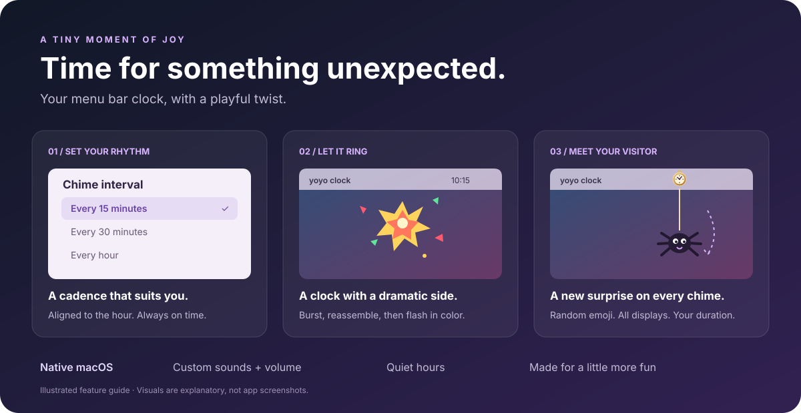

<div align="center">

# yoyo clock

**a macos app that drops a yoyo from your taskbar at an interval of your choosing**

A little clock. A tiny explosion. An unexpected visitor.

[](#build--run)
[](#build--run)
[](LICENSE)



*Illustrated walkthrough, not a screenshot or screen recording.*

</div>

## Make time a little more playful

yoyo clock is a native Swift macOS menu bar app. An ornate Victorian pocket
watch lives in your menu bar until your next chime. When it's time, the watch
bursts apart and reassembles while a random emoji drops on a string and bounces
up and down. A spider, a witch, a ghost, a rocket... each chime is a surprise.

- **On the clock:** chime every 5, 10, 15, 30, or 60 minutes, aligned to the hour.
- **A small spectacle:** clock explosion followed by red, green, and yellow flashes.
- **Your kind of yo-yo:** random emoji, with a configurable 1–10 second animation
  (3 seconds by default).
- **Across your workspace:** synchronized yo-yo animations on every connected display.
- **Sound your way:** choose a macOS alert sound and adjust its playback volume.
- **Quiet when you need it:** quiet hours suppress scheduled sound and animations.
- **Native and lightweight:** AppKit + SwiftUI, saved preferences, no third-party
  package dependencies, and optional launch at login.

## Build & run

Requires **macOS 13 or later** and **Swift 5.9 or later**, provided by Xcode or
Apple's Command Line Tools. Full Xcode is not required for the build script.

```bash
# If you don't have Apple's Command Line Tools yet:
xcode-select --install
```

From a local checkout:

```bash
./build.sh
open "build/yoyo clock.app"
```

The script builds a release executable, assembles the `.app`, and signs it
ad hoc for local use. To keep it installed, quit the running app, copy
`build/yoyo clock.app` into `/Applications`, and launch that copy.

> This is a source-build workflow, not a notarized download or a Mac App Store
> release. Ad-hoc signing is not a substitute for Apple's distribution signing.

## Your first chime

1. Click the **pocket watch** in the menu bar.
2. Choose **Interval** → your preferred cadence.
3. Select **Test Chime Now** to see the explosion, emoji yo-yo, and color flashes
   immediately, with sound if enabled.
4. Open **Preferences…** to customize the effects, duration, sound, and quiet hours.

| Control | What it changes |
| --- | --- |
| Chimes Enabled | Pause or resume scheduled chimes |
| Interval | Every 5, 10, 15, 30, or 60 minutes |
| Explode the clock when it rings | Enable or disable the clock burst |
| Blink the menu bar icon / Flashes | Enable color cycling and choose 1–20 flashes |
| Drop a yo-yo / Duration | Enable the emoji animation and choose 1–10 seconds |
| Play a sound / Sound / Volume | Enable audio, pick a sound, and set 0–100% playback volume |
| Quiet hours | Suppress scheduled chimes between the selected hours |
| Launch at Login | Request automatic startup through macOS |
| Announce Time (Irish Voice) | Speak the current time whenever the yo-yo drops; toggle from the menu or Preferences |

Each effect has its own **Test** button in Preferences. Manual tests preview
effects immediately, including during quiet hours. Audio volume is relative
to your Mac's output volume and does not override system mute.

**Announce Time (Irish Voice)** is built into the app and enabled by default.
Whenever the yo-yo drops, including its Test button, it speaks the current time
using an installed English (Ireland) voice such as **Moira**. It uses the app's
volume slider, independently of the chime sound toggle. Scheduled speech follows
quiet hours and pauses with chimes; disabling the yo-yo also suppresses speech.
Repeated triggers replace the previous announcement rather than queueing it.

If no Irish voice is installed, the app explains how to install one in macOS
Accessibility voice settings; it never silently substitutes a different accent.
It does not change macOS Clock Options. If you previously enabled macOS's own
time announcements, disable them there to avoid duplicate announcements.

### Timing, explained

Intervals follow wall-clock boundaries, not a countdown from when you open the
app. With a 15-minute interval, chimes occur at **:00, :15, :30, and :45**.
At 10:07, the next chime is 10:15.

The app reschedules after waking from sleep; it does not replay all missed
chimes. Keep it running for reminders. Closing Preferences leaves it in the
menu bar; **Quit yoyo clock** stops it.

On secondary displays, the yo-yo mirrors the clock's distance from the right
edge; exact alignment can differ when menu bar layouts differ between screens.

## Under the hood

Run `bash test.sh` to check time phrasing and Irish voice selection without
playing audio or changing system settings.

| File | Responsibility |
| --- | --- |
| `Sources/MenuBarChime/AppDelegate.swift` | Status item, menus, settings window, and chime orchestration |
| `ChimeScheduler.swift` | Wall-clock scheduling and wake handling |
| `StatusIconFactory.swift` | Victorian watch artwork and explosion frames |
| `ExplosionAnimator.swift` / `Blinker.swift` | Clock burst and color flashes |
| `YoyoAnimator.swift` | Click-through, synchronized emoji overlays across displays |
| `Settings.swift` / `PreferencesView.swift` | Persisted options and native settings UI |
| `SoundPlayer.swift` | macOS sound playback |
| `build.sh` | Build, bundle, and local signing |

The internal target directory and bundle identifier retain the original
`MenuBarChime` name to preserve existing settings. The product and visible app
name are **yoyo clock**.

## License

[MIT](LICENSE) — use it, remix it, and make time more fun.
